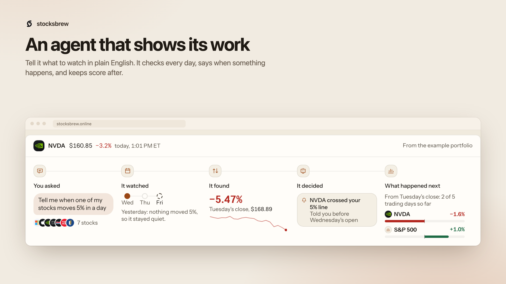
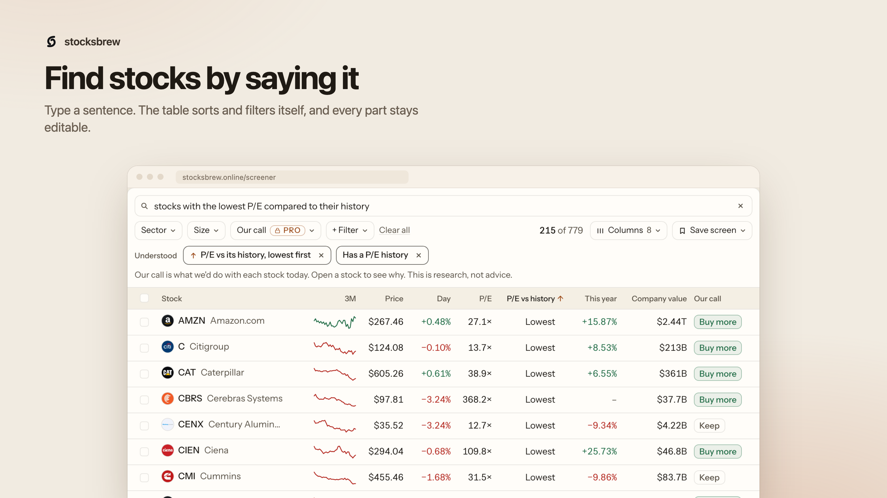
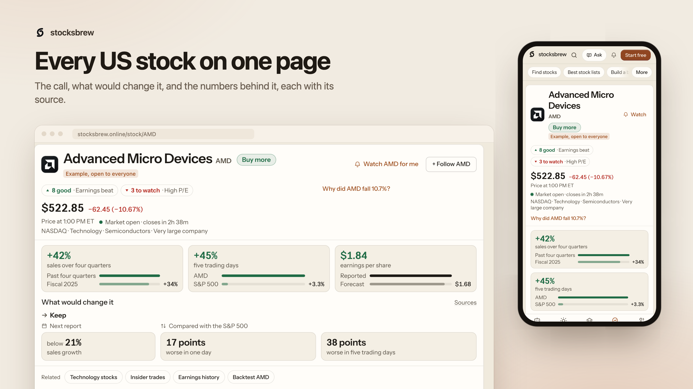
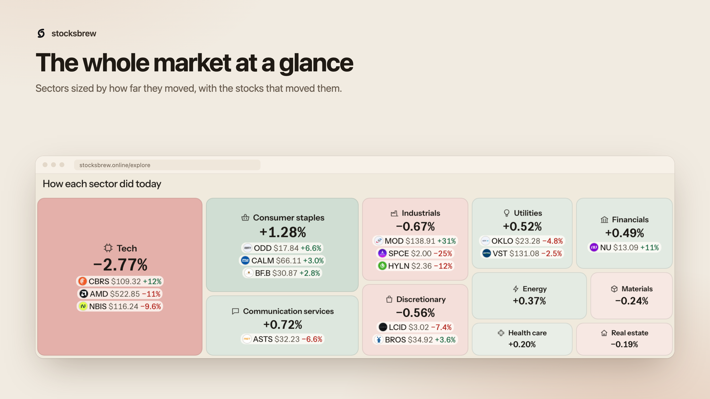

# stocksbrew

stocksbrew helps people analyse and track US stocks. Open any US stock and you get its price history, financials from SEC filings, valuation, earnings, analyst targets, news and a plain-language read of what changed, with the source and the time next to every number. Add the stocks you own or watch, and it keeps their research current: a daily briefing on what moved them and why, alerts for earnings and price levels, and small agents that check a rule for you and report back. It is a research tool. It does not connect to a broker or a bank and it never places trades.

This repository is the whole product: the Next.js web app, the document store it reads from, and the Python jobs that fetch and compute the data.

## Screenshots



| | |
|---|---|
|  |  |



All four are the signed-out app on live data, November 2026.

## What it does

- **Stock pages** (`/stock/NVDA`): price chart, key stats, our call (add, hold or trim) with its reasons and date, financials, earnings, analyst targets, ownership, filings and news.
- **Portfolio** (`/watchlist`): what you own and what you watch, with positions, analytics, alerts and a tax view.
- **Briefing** (`/briefing`): what moved the market or your stocks today, and the reason when we found one.
- **Explore**: the wire (`/news`), `/calendar`, `/screener`, `/themes`, `/signals`, `/markets`, `/filings`, `/compare`.
- **Follow** (`/follow`): 13F fund portfolios, congressional trade reports and Form 4 insider trades.
- **Test ideas**: `/strategies` (rule-based baskets, backtested and live records kept apart), `/backtest`, and a `/practice` account with paper money.
- **Ask** (`/ask`): questions about a stock or your list, answered from the same data with sources.
- **Agents** (`/agents`): standing jobs that check a rule or an event and end every run with a decision, including "nothing to do".
- **Developers** (`/developers`): a REST API under `/api/v1`, an MCP server at `/api/mcp` and a small CLI in `packages/stocksbrew-cli`.

When data doesn't exist we show nothing rather than a zero, and simulated numbers are labelled with their period.

## What we won't build

- No brokerage or bank connections.
- No order placement, copy trading or "it trades for you".
- No claims that a call predicts returns.

Pull requests that add any of these will be closed.

## Architecture

```
  browser ──> Next.js 13.5 app (app/, components/, lib/) ──> Firebase Auth (sign-in only)
                       │
                       │ HTTPS + bearer token, Firestore-shaped adapter (lib/local-firestore.ts)
                       v
              LocalDB: SQLite document store with an HTTP API (backend/localdb)
                       ^
                       │ writes over HTTP, or straight into the SQLite file on the same machine
                       │
              Python jobs (backend/, backend/agentdata/) run by systemd timers
                       │
                       v
              SEC EDGAR, price, news and filing providers, LLM APIs
```

- **Web app.** Next.js 13.5 app router, React 18, Tailwind. Every product page lives under `app/(app)/` and shares one shell (sidebar on desktop, tab bar on phones). Old URLs from before the 2026-11 rebuild are redirected in `next.config.js`.
- **LocalDB.** A small SQLite document store with a Firestore-like HTTP API. Server code never talks to SQLite directly: `lib/firebase-admin.ts` exports a `adminFirestore` object, and when `LOCALDB_URL` and `LOCALDB_API_TOKEN` are set it is the adapter in `lib/local-firestore.ts`, which speaks HTTP to LocalDB. Firestore itself is kept only for an explicit rollback (`FIRESTORE_BACKEND=firebase`). Contract: [`docs/local-db-migration.md`](docs/local-db-migration.md).
- **Firebase.** Auth only: sign-in in the browser, session cookies verified with Firebase Admin on the server.
- **Python jobs.** Two families. `backend/agentdata/` (standard library only) fetches SEC filings, 13F, Form 4, House reports, prices, calendars, markets and the screener, in four groups on timers. The older lanes in `backend/` (run through `backend/cloudrun/orchestrator/dispatch.py`) handle quotes, news, the per-stock briefs, movers and emails. Schedules: [`docs/data-jobs.md`](docs/data-jobs.md).
- **The brief pipeline.** Twice a trading day (open and close) a chain of lanes fetches news for the covered stocks, refreshes prices, writes a brief per stock with an LLM, and explains the day's biggest movers. Each lane starts when the one before it succeeds.
- **The call engine.** A rules-based scorer (`backend/call_engine.py`, run daily by `backend/agentdata/call_scores.py`) that ranks each stock against its peers and sets add, hold or trim. `CALL_ENGINE_MODE` decides whether the brief pipeline ignores it (`off`, the default), stores it next to the old LLM call for comparison (`shadow`), or uses it as the call (`on`).

More detail: [`docs/architecture.md`](docs/architecture.md).

## Run it locally

### 1. What you need

- Node 20 or newer and npm
- Python 3.11 or newer
- A Firebase project of your own (free tier is enough) for sign-in. Create a web app in it for the browser config and a service account key for the server.

### 2. Install

```sh
git clone <this repo> stocksbrew && cd stocksbrew
npm install
python3 -m venv .venv && . .venv/bin/activate
pip install -r backend/requirements.txt
```

### 3. Environment

```sh
cp .env.example .env.local
```

`.env.example` lists every variable the code reads, grouped, with a one-line comment each. Server code loads `.env.local`, then `.env.vps.local`, `.env` and `backend/.env` (the first value set wins); Python jobs read the same files. You only need a handful to start:

| Variable | Needed for | Without it |
|---|---|---|
| `LOCALDB_URL`, `LOCALDB_API_TOKEN` | **required**: the database | the server throws on the first request |
| `FIREBASE_SERVICE_ACCOUNT_PATH` (or `_JSON`) | **required**: Firebase Admin, session checks | the server throws on the first request |
| `NEXT_PUBLIC_FIREBASE_*` | sign-in in the browser | the site renders signed out; sign-in fails |
| `NEXT_PUBLIC_APP_URL` | checkout return URL and some absolute links | checkout returns to localhost:3000 |
| `ANTHROPIC_API_KEY`, `OPENAI_API_KEY` or `OPENROUTER_API_KEY` | Ask, and the LLM steps in jobs | Ask answers from fixed rules in development and returns 503 in production; LLM-written briefs and summaries are not produced |
| `SEC_USER_AGENT` | SEC EDGAR jobs | SEC rejects requests without a contact |
| `FINNHUB_API_KEY`, `MARKETAUX_API_KEY`, `TAVILY_API_KEY`, ... | extra news and web search | that source is skipped; the rest runs |
| `DODO_*` | checkout and subscriptions | checkout fails; everything else works |
| `BREVO_API_KEY`, `EMAILS_ENABLED=1` | email | nothing is sent (the default) |
| `NEXT_PUBLIC_POSTHOG_*`, `NEXT_PUBLIC_GA_MEASUREMENT_ID` | analytics | no analytics |

Never commit a filled env file. `.gitignore` covers every `.env*` except `.env.example`.

### 4. Start the document store

With an empty database:

```sh
export LOCALDB_API_TOKEN=$(openssl rand -hex 32)   # put the same value in .env.local
mkdir -p .localdb
LOCALDB_PATH=.localdb/documents.sqlite3 python3 -m backend.localdb.server
# localdb listening on 127.0.0.1:8500
```

Then set `LOCALDB_URL=http://127.0.0.1:8500` in `.env.local`. `curl http://127.0.0.1:8500/health` should answer `{"ok":true,"service":"localdb"}`. The database file and `.localdb/` are gitignored.

There is no sample dataset in the repo (provider terms don't allow shipping fetched data), so a new store starts empty and pages show their empty states until jobs have written something.

### 5. Run the app

```sh
npm run dev        # http://localhost:8000
```

### 6. Fill some data

Run one job group, or one module, against your LocalDB. With `LOCALDB_PATH` set, `backend/agentdata` jobs write the SQLite file directly; with `LOCALDB_URL` and `LOCALDB_API_TOKEN` they go over HTTP.

```sh
python3 -m backend.agentdata.schedule --list                 # the four groups and their jobs
python3 -m backend.agentdata.schedule --group hourly --dry-run
python3 -m backend.agentdata.news_feed --days 3              # one job: the wire
python3 -m backend.agentdata.sec_filings --days 7            # one job: SEC filings (needs SEC_USER_AGENT)
python3 -m backend.agentdata.backtest_strategies             # daily prices, strategies
```

The older pipeline lanes run through the dispatcher (they need more keys; start with `--dry-run`):

```sh
python3 -m backend.cloudrun.orchestrator.dispatch --executor local --lane price_core_open --market US --limit 20 --dry-run
```

Every job, its schedule and what it writes: [`docs/data-jobs.md`](docs/data-jobs.md).

## Tests and checks

```sh
npx tsc --noEmit                        # typecheck
npx vitest run                          # web and lib tests
npx eslint app components lib           # lint (npm run lint lints everything)
python3 -m pytest backend/tests         # backend tests (pip install pytest first)
node scripts/oss/scan.mjs --tree        # secret and personal-data scan of the working tree
```

`npm run backend:test` runs the backend tests with `unittest` instead; a few test files use plain pytest functions, so pytest is the one to use. The CLI package has its own tests: `cd packages/stocksbrew-cli && npm test`.

## Project layout

```
app/
  (app)/            every product page: briefing, stock/[symbol], watchlist, explore, follow, agents, ...
  api/              route handlers: app APIs, /api/v1 (REST), /api/mcp (MCP server), auth, subscription webhooks
  page.tsx          the landing page
  sitemap.xml/ sitemaps/ robots.txt/ llms.txt/ feed.xml/   SEO routes
  dev/              local-only tools (404 in production)
components/
  oa/kit/           the page kit: AppPage, PageHead, Panel, StatStrip, TabBar, DataTable, formatters
  oa/               shell (sidebar, tab bar, header), landing sections, gates and lock cards
  <feature>/        one folder per surface: briefing, portfolio, follow, screener, ask, ...
lib/                data loaders, insight builders ("the read"), entitlements, blog and docs content
backend/
  agentdata/        standard-library jobs for filings, funds, insiders, prices, markets, screener, call scores
  localdb/          the SQLite document store and its HTTP server
  cloudrun/         the lane dispatcher the VPS uses (the Cloud Run deploy path itself is retired)
  scripts/          one module per pipeline step (prices, news, briefs, views, emails)
  vps/              run scripts and systemd units for a single Linux server
  tests/            backend tests
packages/stocksbrew-cli/   the CLI client for the API
scripts/            SEO helpers, the agent runner (run-agent-jobs.ts), the OSS scanner
docs/               architecture, data jobs, product voice, pipeline notes, screenshots
remotion/           the launch video
```

## Free and Pro

Reading is free: the call and when it was made, filings, fund pages, strategy rules and backtests are open to everyone, signed in or not. A plan decides how much the product works for you: the number of covered stocks (5 on Free, all on Pro), which get price zones, the reasons behind the call, explained moves and alerts, plus small counts elsewhere (Ask questions, agents, backtests per day). Every limit lives in one table in [`lib/entitlements.ts`](lib/entitlements.ts); the server reads it to decide what to load (`lib/entitlements-server.ts`, `canSeeLevels`), the lock cards take their words from it, and `/pricing` renders it. Gated data is removed on the server before it reaches the browser, never just hidden.

## Deployment

The production setup is one Vercel project for the web app and one small Linux server for everything else.

- **Web app on Vercel.** `npm run build`, with the env vars from `.env.example` set in the Vercel project (at least `LOCALDB_URL`, `LOCALDB_API_TOKEN`, the Firebase ones and `REVALIDATE_TOKEN`).
- **LocalDB and jobs on a server.** The repo is checked out on the server, LocalDB runs as a systemd service bound to `127.0.0.1:8500`, and Caddy terminates TLS in front of it (`backend/vps/Caddyfile` reads the host and IP from the environment). `backend/vps/install-systemd.sh` installs the pipeline timers, `backend/vps/units/` holds the agent data timers, and `run-dispatch.sh` / `run-agentdata.sh` run one lane or group. Updating is `git pull --ff-only` on the server and restarting the services that changed. See [`backend/vps/README.md`](backend/vps/README.md).
- Jobs tell the web app to refresh cached pages through `/api/revalidate` with `WEB_REVALIDATE_TOKEN`, which must match the app's `REVALIDATE_TOKEN`.

Keep `LOCALDB_API_TOKEN` long and random: it is the only thing between the internet and the database.

## Data sources and their terms

The code is open source. The data is not ours to give away. Each provider has its own terms, and several forbid redistribution or commercial use of what they return. If you run stocksbrew, you are responsible for having the right to use each source the way you use it.

| Source | Used for | Note |
|---|---|---|
| SEC EDGAR | filings, XBRL financials, Form 4, 13F | public data; follow the fair-access policy (User-Agent with a contact, at most 10 requests a second; the jobs stay under 8) |
| House Clerk disclosures | congressional trade reports | public, but federal law restricts some uses of these reports; read the rules first |
| Yahoo Finance (via `yfinance`) | prices, quotes | unofficial; Yahoo's terms limit use to personal, non-commercial |
| Alpha Vantage, Finnhub, Marketaux, Twelve Data | prices, news, calendars | API keys and terms per provider; free tiers usually forbid redistribution |
| OpenFIGI | CUSIP to ticker mapping | free API with terms |
| Finviz, Zacks, StockAnalysis, Nasdaq, TradingView, CNN, Tickertape, Screener.in | metrics, targets, sentiment | fetched from public pages; their terms may forbid automated access. Disable these providers unless you have permission |
| Reddit, Truth Social (ScrapeCreators), Polymarket, Kalshi, CoinGecko | signals, markets | each API's terms apply |
| Tavily, Firecrawl | web search and article extraction | API terms apply |
| OpenAI, Anthropic, OpenRouter | written summaries and Ask | API terms apply |

Do not commit fetched data, caches or database files.

## Contributing, security, license

- How to set up, test and send a change: [CONTRIBUTING.md](CONTRIBUTING.md).
- Found a vulnerability? Report it privately: [SECURITY.md](SECURITY.md).
- License: being finalised. The proposal (AGPL-3.0-or-later for the app, MIT for the CLI) is in [`LICENSE.proposed`](LICENSE.proposed); until a `LICENSE` file lands, no license is granted.
- Contact: tomartarun2001@gmail.com

Nothing on stocksbrew is investment advice.
