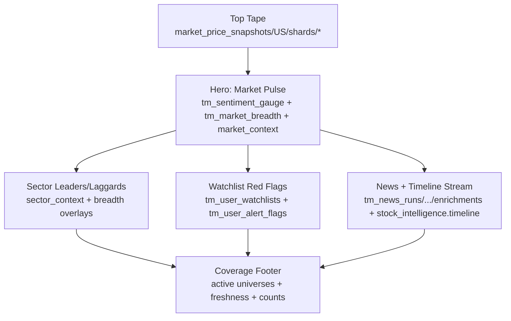
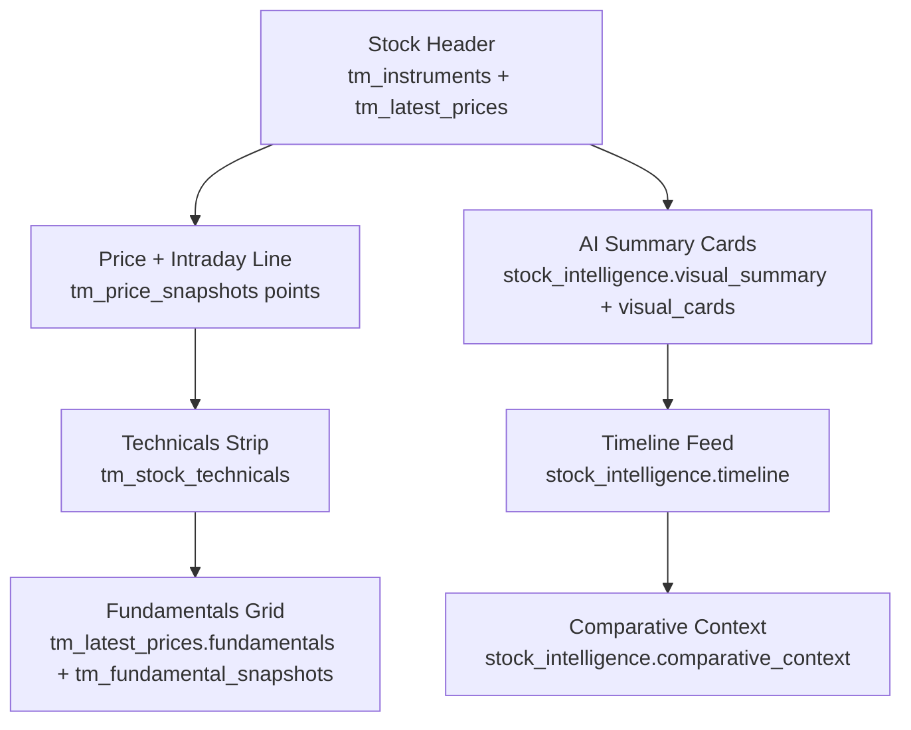

# Trace Money Firestore: Verified Reference

Last verified: April 19, 2026 (IST)  
Verification method: live Firestore reads + code inspection

This file is a strict reference for frontend planning:
1. what is in DB right now (verified)
2. what each collection is used for
3. real examples (market, sector, stock)
4. current gap for "price for broad universe + AI for small universe"

## 1) Active Universe State (live)

`tm_config/active_universes` currently:

```json
{
  "IN": "in_test_5",
  "US": "us_test_12",
  "updated_at": "2026-04-19T11:07:08.828153+00:00"
}
```

Important:
- `US_price_universe` and `US_ai_universe` keys are not present yet in Firestore.
- Backend supports them in code (`save_active_price_universe`, `save_active_ai_universe`), but active config is still on legacy key `US`.

## 2) Verified Collection Inventory

Counts below are from live reads at verification time.

### A) Core config
- `tm_config/active_universes`
- `tm_config/instrument_universe`
- `tm_config/instrument_universe_state`

### B) Instruments and prices
- `tm_instruments` (US docs: `100`)
  - doc id: `{instrument_id}` like `US_NVDA`
- `tm_latest_prices` (total docs: `313`)
  - doc id: `{instrument_id}`
- `tm_price_snapshots` (total parent docs: `313`)
  - subcollection: `/points/{point_id}`
- `tm_fundamental_snapshots` (total docs: `17`)

### C) Market snapshot shards (frontend-friendly list)
- `market_price_snapshots/US/shards/{shard_id}`
  - current rows in US snapshot: `152`
  - row schema in this collection uses camelCase keys:
    - `instrumentId`, `symbol`, `name`, `sectorId`, `lastUpdated`, `price{...}`

### D) AI/news namespaces
- `tm_news_runs` total namespace docs: `5`
  - includes: `US__us_test_12`, `US__us_test_10`, `US__us_test_5`, `US__us_core_100`, `IN__in_test_5`

For active US AI namespace (`US__us_test_12`):
- `/articles`: `31`
- `/enrichments`: `31`
- `/stock_intelligence`: `10`
- `/market_context/overview`: exists
- `/sector_context`: `4`
- `/market_run_summaries`: `1`

### E) Materialized views
- `tm_views_dashboard` docs: `5`
- `tm_views_instrument` docs: `132`

## 3) Real Data Structures (verified)

## A) Market context (US)
Path: `tm_news_runs/US__us_test_12/market_context/overview`

Keys present:
- `market`, `universe_id`, `generated_at`, `source`
- `today_label`, `today_score`, `today_brief`, `today_key_points[]`
- `week_label`, `week_score`, `week_brief`, `week_key_points[]`
- `top_sectors[]`, `article_count`
- `visual_summary{ what_changed, why_it_matters, what_to_watch }`

Example values:
- `today_label`: `mixed`
- `today_score`: `49`
- `top_sectors`: `["Technology", "Consumer Discretionary", "Industrials"]`

## B) Sector context (US)
Path: `tm_news_runs/US__us_test_12/sector_context/{sector_id}`

Sector docs currently present:
- `communication-services`
- `consumer-discretionary`
- `industrials`
- `technology`

Keys present:
- `sector_id`, `sector_label`, `market`, `universe_id`, `generated_at`
- `today_label`, `today_score`, `today_brief`, `today_key_points[]`
- `week_label`, `week_score`, `week_brief`, `week_key_points[]`
- `visual_summary{ what_changed, why_it_matters, what_to_watch }`
- `article_count`
- `evidence{ gate_passed, article_count, distinct_ticker_count, source_count, min_articles, min_distinct_tickers, min_sources }`

## C) Stock intelligence (US)
Path: `tm_news_runs/US__us_test_12/stock_intelligence/{instrument_id}`

Stock docs currently present:
- `US_AAPL`, `US_AMD`, `US_GOOGL`, `US_INTC`, `US_LMT`, `US_META`, `US_NVDA`, `US_PLTR`, `US_TSLA`, `US_TSM`

Example presence check:
- `US_NVDA`: exists
- `US_MSFT`: missing (no stock_intelligence doc in active namespace)

Keys present in `US_NVDA`:
- identity/meta: `instrument_id`, `market`, `universe_id`, `generated_at`, `as_of`
- summary text: `headline`, `thesis`, `body`, `today_brief`, `week_summary`, `catalyst`, `risk`
- signal: `overall_label`, `overall_score`, `lanes[]`, `setup_state`
- relations: `key_points[]`, `related_instrument_ids[]`, `mention_volume_series[]`
- timeline: `timeline[]`
- quality: `data_quality{...}`
- context: `comparative_context{...}`, `market_context{...}`, `sector_context{...}`, `run_context{...}`
- visuals: `visual_summary{...}`, `visual_cards{ drivers[], catalyst_cards[], risk_cards[] }`

## 4) Price Universe vs AI Universe: Current Reality

## What code supports
- Backend now supports split keys:
  - `US_price_universe`
  - `US_ai_universe`
- `sync_price_snapshots --activate` sets price universe.
- `materialize_views --activate` sets AI universe.
- Legacy `US` key is still written as fallback for compatibility.

## What DB currently shows
- Only legacy `US` key is present (`us_test_12`).
- So current runtime effectively behaves as single-universe mode.

## What this means for your product idea
Your idea is valid and aligns with current architecture direction:
- price data for broad universe (e.g., `us_core_155`)
- AI intelligence for smaller universe (e.g., `us_test_12`)
- frontend can always show price rows and mark AI as unavailable for non-AI symbols

But this is **not fully activated yet in Firestore state**.

## 5) Frontend Data Contract Notes

If frontend reads `market_price_snapshots`, use these keys:
- `instrumentId` (not `instrument_id`)
- `lastUpdated` (not `captured_at`)
- `price.current`, `price.changePct`, `price.volume`

If frontend reads `tm_latest_prices`, use snake_case keys:
- `instrument_id`
- `captured_at`
- `quote.current`, `quote.day_change_pct`, `quote.volume`

Mixing those schemas causes empty fields.

## 6) Instrument Universe Catalog (code config)

From `backend/config/instrument_universe.json` (US):
- `us_test_5`: 5 symbols
- `us_test_10`: 10 symbols
- `us_test_12`: 12 symbols
- `us_price_8`: 8 symbols
- `us_core_100`: 100 symbols
- `us_core_155`: broad US equity universe (see `instrument_universe.json` for the current member list)

## 7) Quick UI Mockup Shapes (from real docs)

These are not invented fields; they map to current DB docs.

### A) Market card block
```text
US Market Today
Sentiment: mixed (49)
What changed: <market_context.visual_summary.what_changed>
Why it matters: <market_context.visual_summary.why_it_matters>
Watch next: <market_context.visual_summary.what_to_watch>
Top sectors: Technology | Consumer Discretionary | Industrials
Coverage: 31 articles
```

### B) Sector card block
```text
Technology
Sentiment: bullish (75)
What changed: <sector.visual_summary.what_changed>
Why it matters: <sector.visual_summary.why_it_matters>
Watch next: <sector.visual_summary.what_to_watch>
Evidence: articles=<evidence.article_count>, tickers=<evidence.distinct_ticker_count>, sources=<evidence.source_count>
```

### C) Stock card block (NVDA)
```text
NVDA | NVIDIA Corporation
Price: <tm_latest_prices.quote.current>  Day: <tm_latest_prices.quote.day_change_pct>%
AI Label: bullish (85)
Headline: NVIDIA's Growth Potential Highlighted by Analyst Prediction
What changed: <stock.visual_summary.what_changed>
Catalysts: <stock.visual_cards.catalyst_cards[]>
Risks: <stock.visual_cards.risk_cards[]>
Timeline: <stock.timeline[]>
Data quality: confidence=<stock.data_quality.confidence_score>, freshness=<stock.data_quality.freshness_status>
```

## 8) Landing Page Visual Blueprint (Card-Heavy)

This section shows a realistic landing page composition using fields we already have in Firestore today.

### A) Layout map (visual)



### B) Card wireframe (visual)

```text
+------------------------------------------------------------------------------------------------------------------+
| TOP TAPE                                                                                                         |
| NVDA 201.68 +1.68% | AMD 278.39 +0.05% | MSFT 422.79 +0.60% | ... (from market_price_snapshots rows[])         |
+------------------------------------------------------------------------------------------------------------------+
| MARKET PULSE                                      | FEAR/GREED GAUGE                | BREADTH                    |
| mixed (49)                                        | Score: <tm_sentiment_gauge.score>| Adv/Dec: <adv>/<dec>       |
| <market_context.visual_summary.what_changed>      | Label: <tm_sentiment_gauge.label>| High/Low: <newH>/<newL>    |
| <market_context.visual_summary.why_it_matters>    | [#######-----]                  | Up/Down Vol: <uVol>/<dVol> |
| <market_context.visual_summary.what_to_watch>     | (components breakdown chips)     | %>20/50/200 DMA            |
+---------------------------------------------------+----------------------------------+----------------------------+
| TOP SECTORS (cards)                                                                                              |
| [Technology | bullish 75 | top driver line] [Consumer Discretionary | bullish 80 | top driver line] ...        |
+------------------------------------------------------------------------------------------------------------------+
| WATCHLIST RED FLAGS (demo_user)                    | TODAY NEWS + EVENTS (stream)                                        |
| [NVDA][ALERT][severity 5] price shock, risk spike  | [time] headline + sentiment + ticker tags                            |
| [AAPL][CLEAR]                                      | [time] headline + sentiment + ticker tags                            |
| [TSLA][ALERT] volume anomaly                       | [time] headline + sentiment + ticker tags                            |
+------------------------------------------------------------------------------------------------------------------+
```

### C) Card-to-Firestore bindings

- `Top Tape`
  - source: `market_price_snapshots/US/shards/*`
  - fields: `symbol`, `price.current`, `price.changePct`, `lastUpdated`

- `Market Pulse`
  - source: `tm_news_runs/US__{activeAiUniverse}/market_context/overview`
  - fields: `today_label`, `today_score`, `visual_summary.*`, `article_count`, `top_sectors[]`

- `Fear/Greed Gauge`
  - source: `tm_sentiment_gauge/US_{date}`
  - fields: `score`, `label`, `components[]`, `explanation`

- `Breadth`
  - source: `tm_market_breadth/US_{date}`
  - fields: `advancers`, `decliners`, `unchanged`, `new_52w_high`, `new_52w_low`,
    `up_volume`, `down_volume`, `pct_above_20dma`, `pct_above_50dma`, `pct_above_200dma`

- `Sector cards`
  - source: `tm_news_runs/US__{activeAiUniverse}/sector_context/{sector_id}`
  - fields: `sector_label`, `today_label`, `today_score`, `visual_summary.*`, `evidence.*`

- `Watchlist Red Flags`
  - source: `tm_user_watchlists/{userId}`, `tm_user_alert_flags/{userId}_{instrumentId}`
  - fields: `status`, `severity_score`, `flag_count`, `flags[]`

## 9) Stock Detail Page Visual Blueprint (Card-Heavy)

### A) Layout map (visual)



### B) Stock page wireframe (visual)

```text
+------------------------------------------------------------------------------------------------------------------+
| NVDA  NVIDIA Corporation                 NASDAQ      Price 201.68   +1.68%      Updated <captured_at>           |
+------------------------------------------------------------------------------------------------------------------+
| PRICE CARD                                          | AI SUMMARY                                                  |
| 1D line chart (tm_price_snapshots points)           | What changed: <visual_summary.what_changed>                 |
| low <quote.low>  high <quote.high>                  | Why it matters: <visual_summary.why_it_matters>             |
| open <quote.open> prev close <quote.previous_close> | What to watch: <visual_summary.what_to_watch>               |
+-----------------------------------------------------+--------------------------------------------------------------+
| TECHNICALS                                                                                                        |
| RSI14: 58 (neutral) | SMA20: above | SMA50: above | SMA200: insufficient_data | EMA20 slope: rising             |
| Dist from 52W High: -12.4% | Dist from 52W Low: +45.1%                                                      |
+------------------------------------------------------------------------------------------------------------------+
| DRIVERS / CATALYSTS / RISKS                                                                                        |
| [Driver card] [Driver card] [Catalyst card] [Risk card]                                                          |
+------------------------------------------------------------------------------------------------------------------+
| TIMELINE (latest events)                                                                                           |
| [t1] title | bearish | impact 4 | source                                                                          |
| [t2] title | neutral | impact 2 | source                                                                          |
+------------------------------------------------------------------------------------------------------------------+
| FUNDAMENTALS GRID                                   | COMPARATIVE CONTEXT                                         |
| Market Cap | PE TTM | Dividend Yield | 52W Low/High | vs Market Day Change | vs Sector | Percentile             |
+------------------------------------------------------------------------------------------------------------------+
```

### C) Stock card-to-Firestore bindings

- `Header`
  - `tm_instruments/{instrumentId}`: `ticker`, `name`, `exchange`, `sector`
  - `tm_latest_prices/{instrumentId}`: `quote.current`, `quote.day_change_pct`, `captured_at`

- `Price card + line`
  - `tm_latest_prices/{instrumentId}`: `quote.open`, `quote.high`, `quote.low`, `quote.previous_close`, `quote.volume`
  - `tm_price_snapshots/{instrumentId}/points/*`: line series

- `AI Summary`
  - `tm_news_runs/US__{activeAiUniverse}/stock_intelligence/{instrumentId}`:
    `visual_summary`, `headline`, `today_brief`, `week_summary`

- `Visual driver cards`
  - same stock intelligence doc: `visual_cards.drivers[]`, `visual_cards.catalyst_cards[]`, `visual_cards.risk_cards[]`

- `Technicals`
  - `tm_stock_technicals/{instrumentId}_{date}`:
    `rsi_14`, `moving_averages`, `distance.from_52w_high_pct`, `distance.from_52w_low_pct`

- `Timeline`
  - stock intelligence `timeline[]`

- `Comparative context`
  - stock intelligence `comparative_context.*`, `data_quality.*`

## 10) Verified Availability for These Visuals (as of April 19, 2026)

- `tm_market_breadth/US_2026-04-19`: exists
- `tm_sentiment_gauge/US_2026-04-19`: exists
- `tm_stock_technicals` docs for `2026-04-19`: `12`
- `tm_user_watchlists/demo_user`: exists
- `tm_user_alert_flags` for `demo_user`: `8` docs

This means both the landing wireframe and stock wireframe above are buildable now with current data.
